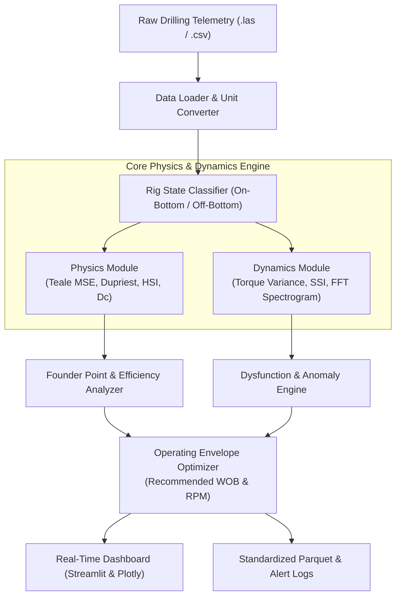

# 🛠️ DrillOpt-Engine: Real-Time Drilling Mechanics & MSE Optimization

> **Documento de Especificación, Arquitectura y Roadmap del Proyecto**  
> **Área:** Upstream / Drilling Engineering & Real-Time Operations  
> **Autor:** Tiago Meilan  
> **Fecha de Creación:** Octubre 2026  

---

## 1. Visión y Justificación Estratégica

### 1.1 Contexto de Industria
La perforación de pozos no convencionales en formaciones complejas como **Vaca Muerta** exige perforar ramas laterales que superan los **2.500 a 3.500 metros** en horizontes estrechos de navegación geológica. En este entorno:
- La tasa diaria de alquiler de un equipo de perforación moderno (*Rig Day Rate*) ronda entre **\$30.000 y \$60.000 USD/día** (llegando a más de \$100.000 USD/día con servicios integrados de MWD/LWD y fluidos).
- El **tiempo no productivo (NPT - Non-Productive Time)** debido a fallas de herramientas de fondo (BHA), desgaste prematuro del trépano de PDC (*Polycrystalline Diamond Compact*) o aprisionamiento de sarta representa millones de dólares en pérdidas anuales para operadoras (YPF, Vista, Pan American Energy, Tecpetrol) y compañías de servicios (Baker Hughes, SLB, Halliburton, Nabors).
- Realizar una maniobra de extracción de sarta a 3.000 metros de profundidad (*tripping pipe*) para reemplazar un trépano roto insume entre **24 y 48 horas de equipo paralizado** (\$50.000 – \$120.000 USD solo en costo de taladro, sin contar el trépano nuevo).

### 1.2 Propuesta de Valor del Proyecto
`DrillOpt-Engine` es una **herramienta analítica y motor de cálculo de física en tiempo real** que procesa telemetría de perforación (superficie y fondo) para:
1. **Calcular la Eficiencia Mecánica Real:** Implementar la formulación de **Mechanical Specific Energy (MSE)** de Teale (1965) y la corrección de eficiencia de Dupriest & Koederitz (SPE 92194 / ExxonMobil, 2005).
2. **Detectar el "Founder Point" Automáticamente:** Identificar el punto de quiebre donde agregar más peso sobre el trépano (*WOB*) deja de incrementar la tasa de penetración (*ROP*) y dispara el desperdicio de energía mecánica.
3. **Identificar Disfunciones y Vibraciones Destructivas:** Detección de *stick-slip* torsional de alta severidad y *bit bounce* mediante análisis de fluctuación y procesamiento espectral de señales (FFT / varianza móvil de torque y RPM).
4. **Optimización de Parámetros de Operación:** Recomendar la ventana óptima de WOB y RPM que maximiza la ROP minimizando el riesgo de falla de sarta y fatiga mecánica.
5. **Dashboard Operativo:** Proveer una interfaz visual interactiva que simule una consola de cabina de perforación (*drilling cabin / real-time operations center - RTOC*).

### 1.3 Diferenciación con `vaca-muerta-dca`
A diferencia del proyecto de DCA (que analiza series mensuales de producción de hidrocarburos a escala de años para reservorios), `DrillOpt-Engine` opera sobre **telemetría de alta frecuencia (segundo a segundo o pie a pie)**, aplicando **dinámica de cuerpos rígidos, mecánica de materiales, torsión elástica, balances de potencia y procesamiento digital de señales**.

---

## 2. Objetivos del Proyecto

### 2.1 Objetivo General
Diseñar, implementar y validar un motor de ingeniería modular en Python para el procesamiento, diagnóstico físico y optimización en tiempo real de operaciones de perforación rotativa, validado con datasets públicos reales de la industria petrolera.

### 2.2 Objetivos Específicos
1. **Pipeline de Ingesta y Estandarización:**
   - Ingestar datos de telemetría de perforación en formatos estándares de la industria: archivos `.las` (Log ASCII Standard vía `lasio`) y `.csv` de telemetría en tiempo (WITS/WITSML-like).
   - Validar y normalizar unidades de ingeniería petrolera (campo vs métrico: psi, gpm, klbf, rpm, ft-lbf, ft/hr, m/hr).
   - Filtrar estados de taladro no operativos (*off-bottom*, conexiones, *reaming*, bombeo sin rotación) para aislar exclusivamente la perforación activa (*on-bottom drilling*).
2. **Modelado Físico y Balances Energéticos:**
   - Implementar el modelo de **Teale (1965)** y **Dupriest (2005)** de Mechanical Specific Energy (MSE).
   - Integrar la relación con la resistencia compresiva de la roca (UCS - *Unconfined Compressive Strength*) para determinar la eficiencia mecánica del trépano ($\text{EFF}_M = \text{UCS} / \text{MSE}$).
   - Calcular el exponente de perforabilidad corregido ($D$-exponent y $D_c$-exponent).
   - Calcular potencia hidráulica en las boquillas del trépano (HSI - *Hydraulic Horsepower per Square Inch*) y balance de caída de presión.
3. **Algoritmos de Detección de Disfunciones:**
   - **Founder Point Detection:** Algoritmo de regresión segmentada / quiebre de pendiente para detectar saturación de corte de roca.
   - **Stick-Slip Severity Index (SSI):** Procesamiento de varianza y análisis espectral (FFT / Fast Fourier Transform) de torque y RPM para diagnosticar resonancia torsional.
   - **Bit Wear Index:** Modelo acumulativo de desgaste abrasivo de los cortadores en función de la energía disipada y la litología.
4. **Motor de Recomendación (Optimizer):**
   - Construir una superficie de respuesta de ROP vs (WOB, RPM).
   - Optimizar la combinación de variables bajo restricciones operativas (torque máximo del motor de fondo/top drive, límite de vibración).
5. **Interfaz de Usuario y Dashboard:**
   - Desarrollar un dashboard interactivo en **Streamlit + Plotly** con vista de *log continuo* (tipo WellCAD / Techlog) y vista de *cabina de perforación* con indicadores de alerta tipo semáforo.
6. **Infraestructura de Software y Calidad:**
   - 100% tipado estático con Python type hints (`mypy`).
   - Suite de tests unitarios y de integración con `pytest` (>85% code coverage).
   - Repositorio listo para GitHub con documentación reproducible y despliegue a Streamlit Cloud.

---

## 3. Stack Tecnológico

| Capa | Herramienta / Librería | Justificación Técnica |
|---|---|---|
| **Lenguaje Core** | `Python 3.11+` | Estándar de la industria para computación científica y data engineering. |
| **Ingesta de Logs** | `lasio` | Estándar petrolero open-source para lectura y parseo de archivos geofísicos `.las` (CWLS). |
| **Computación Vectorial** | `numpy`, `scipy` | Cálculo de balances de energía, optimización no lineal (`scipy.optimize`), filtros y FFT (`scipy.signal`). |
| **Data Manipulation** | `pandas`, `pyarrow` | Manejo de series de tiempo de telemetría de perforación y exportación de datos en formato columnar Parquet. |
| **Modelado / ML** | `scikit-learn` | Regresores robustos (Huber, RANSAC) para ajuste de líneas de perforabilidad sin sesgo por ruido. |
| **Visualización** | `plotly`, `matplotlib` | Gráficos interactivos de perfiles geológicos, gráficos cruzados (WOB vs ROP) y espectrogramas de frecuencia. |
| **Dashboard Web** | `streamlit` | Consola interactiva para ingenieros de operaciones y demostración en vivo. |
| **Testing y QA** | `pytest`, `pytest-cov` | Verificación de precisión numérica de las fórmulas físicas y consistencia de datos. |
| **Control de Calidad** | `ruff`, `mypy` | Linting de alta velocidad y chequeo estricto de tipos de datos. |

---

## 4. Fuentes de Datos Seleccionadas

Para garantizar que el proyecto se valide con datos reales y de nivel de producción (evitando datos sintéticos artificiales):

1. **Equinor Volve Field Dataset (Noruega - Open License):**
   - Dataset público de producción y perforación completo donado por Equinor a la industria.
   - Contiene archivos `.las` de perforación en tiempo real (MWD/LWD) con curvas de: `DEPTH`, `WOB`, `RPM`, `ROP`, `TORQUE`, `SPP` (Standpipe Pressure), `FLOW_IN`.
2. **Utah FORGE / DOE Geothermal & Hard Rock Drilling (US Department of Energy):**
   - Datos abiertos de perforación profunda en formaciones extremadamente duras, ideales para análisis de vibración, stick-slip severo y desgaste de trépano.
3. **Benchmark Sintético Parametrizado (Fallback / Unit Testing):**
   - Módulo generador de telemetría sintética con física acoplada (ecuación diferencial de péndulo torsional para simular stick-slip) utilizado para tests unitarios reproducibles.

---

## 5. Estructura del Proyecto

```text
drilling-optimization-engine/
│
├── .gitignore                      # Ignora datasets pesados crudos, caches y venv
├── README.md                       # Documentación principal para reclutadores y GitHub
├── requirements.txt                # Dependencias fijadas
├── pyproject.toml                  # Configuración de herramientas (ruff, pytest, mypy)
├── LICENSE                         # Licencia MIT
│
├── data/
│   ├── raw/                        # Datos crudos (.las, .csv originales) - en .gitignore
│   └── processed/                  # Datos curados y normalizados (.parquet)
│
├── notebooks/                      # Investigación y validación matemática interactiva
│   ├── 01_data_ingestion_eda.ipynb # Parseo de logs, control de calidad y unidades
│   ├── 02_mse_mechanics.ipynb      # Implementación de Teale & Dupriest MSE
│   ├── 03_founder_point.ipynb      # Algoritmo de detección de saturación de WOB
│   ├── 04_vibration_detection.ipynb# FFT, varianza de torque y diagnóstico de stick-slip
│   └── 05_drilling_optimizer.ipynb # Optimización de parámetros de perforación
│
├── src/                            # Código fuente modular en producción
│   ├── __init__.py
│   ├── data/
│   │   ├── __init__.py
│   │   ├── loader.py               # Lector de archivos .las y .csv con lasio/pandas
│   │   ├── unit_converter.py       # Conversor estricto entre sistemas Métrico e Imperial
│   │   └── rig_state.py            # Filtro de estados de taladro (On-Bottom, Off-Bottom, etc.)
│   │
│   ├── physics/
│   │   ├── __init__.py
│   │   ├── mse.py                  # Ecuaciones de Teale, Dupriest y cálculo de eficiencia
│   │   ├── d_exponent.py           # D-exponent y Dc-exponent normalizado por densidad de lodo
│   │   └── hydraulics.py           # Caída de presión en trépano, HSI y velocidad anular
│   │
│   ├── dynamics/
│   │   ├── __init__.py
│   │   ├── stick_slip.py           # Cálculo de Stick-Slip Severity Index (SSI) y FFT
│   │   ├── bit_bounce.py           # Detección de resonancia axial y micro-impactos
│   │   └── wear_model.py           # Modelo acumulativo de desgaste de cortadores PDC
│   │
│   ├── optimizer/
│   │   ├── __init__.py
│   │   ├── founder_point.py        # Detector de punto de inflexión WOB vs ROP
│   │   └── road_map.py             # Recomendador de ventana óptima operativa (WOB/RPM)
│   │
│   └── app/
│       ├── __init__.py
│       ├── main.py                 # Aplicación interactiva Streamlit
│       ├── components/             # Componentes modulares de UI (gráficos, métricas, alertas)
│       └── utils.py                # Helpers de visualización y cache
│
└── tests/                          # Suite automatizada de pruebas
    ├── test_units.py               # Verificación de conversiones de unidades petroleras
    ├── test_mse.py                 # Validación numérica con casos de estudio SPE de Teale/Dupriest
    ├── test_rig_state.py           # Pruebas de discriminación de estados de taladro
    ├── test_dynamics.py            # Pruebas de cálculo de SSI y análisis de frecuencia
    └── test_optimizer.py           # Pruebas de convergencia del detector de founder point
```

---

## 6. Arquitectura de Software y Flujo de Datos



---

## 7. Infraestructura de Agentes

Para asegurar una ejecución organizada, modular y rigurosa, se definen los siguientes roles especializados dentro del marco de coordinación:

```
AGENTE COORDINADOR
│
├── 📡 Agent 1: data-engineer-agent
│   ├── Parseo de archivos .las (lasio) y CSVs de perforación
│   ├── Mapeo y conversión canónica de unidades de ingeniería (Imperial / Métrico)
│   └── Algoritmo de clasificación de rig states (On-bottom, Off-bottom, Tripping, Reaming)
│
├── ⚙️ Agent 2: drilling-physics-agent
│   ├── Implementación matemática de Mechanical Specific Energy (Teale & Dupriest)
│   ├── Estimación de UCS y eficiencia mecánica de corte
│   └── Cálculos hidráulicos (HSI, presión en toberas, velocidad anular)
│
├── 〰️ Agent 3: dynamics-signal-agent
│   ├── Detección de stick-slip torsional mediante análisis espectral (FFT / Welch PSD)
│   ├── Algoritmo de severidad SSI y monitoreo de varianza de torque de alta frecuencia
│   └── Modelado de desgaste progresivo de cortadores de trépano
│
├── 🎯 Agent 4: optimizer-agent
│   ├── Detección de quiebre de pendiente (Founder Point) mediante regresión segmentada / RANSAC
│   └── Algoritmo de optimización de parámetros de perforación (superficie de respuesta WOB/RPM)
│
├── 🖥️ Agent 5: dashboard-ui-agent
│   ├── Arquitectura del dashboard interactivo en Streamlit + Plotly
│   ├── Visualización de registros de pozo sincronizados (Log Plot multipista)
│   └── Panel de indicadores y alertas de disfunción en tiempo real
│
└── 🧪 Agent 6: qa-docs-agent
    ├── Suite de pruebas automatizadas con pytest
    ├── Verificación de consistencia física con benchmarks de literatura SPE
    └── Redacción del README.md corporativo y preparación para despliegue
```

---

## 8. Roadmap Detallado de Implementación

### Fase 1: Ingesta, Clasificación de Estado y Estandarización de Datos
- **Hito 1.1:** Descargar y aislar una corrida de perforación real de un pozo público (ej. Equinor Volve pozo 15/9-F-14 o similar) que contenga canales de superficie y MWD.
- **Hito 1.2:** Crear `src/data/loader.py` con soporte nativo de `.las` y `.csv`.
- **Hito 1.3:** Crear `src/data/unit_converter.py` con validación estricta de dimensionalidad (longitud, fuerza, presión, caudal, torque).
- **Hito 1.4:** Desarrollar `src/data/rig_state.py` para aislar datos cuando el trépano está efectivamente en el fondo perforando roca viva ($WOB > 0$, $RPM > 0$, $Flow > 0$, $\Delta Depth > 0$).
- **Entregable de Fase 1:** Notebook `01_data_ingestion_eda.ipynb` con logs limpios y clasificados exportados a `.parquet`.

### Fase 2: Motor de Física de Perforación (MSE & Hidráulica)
- **Hito 2.1:** Implementar las ecuaciones de Teale y Dupriest en `src/physics/mse.py`.
- **Hito 2.2:** Implementar el cálculo del exponente $D$ y $D_c$ en `src/physics/d_exponent.py` para monitoreo de cambios litológicos y sobrepresión.
- **Hito 2.3:** Implementar balances hidráulicos en `src/physics/hydraulics.py` (cálculo de HSI y caída de presión en boquillas de trépano).
- **Hito 2.4:** Pruebas unitarias en `tests/test_mse.py` con casos de validación analíticos.
- **Entregable de Fase 2:** Notebook `02_mse_mechanics.ipynb` que grafica MSE continua vs ROP y litología.

### Fase 3: Procesamiento de Señales, Dinámica y Disfunciones
- **Hito 3.1:** Crear `src/dynamics/stick_slip.py` con cálculo de Stick-Slip Severity Index (SSI) y transformada rápida de Fourier (FFT) para identificar picos de frecuencia de resonancia torsional de la sarta.
- **Hito 3.2:** Implementar algoritmo de detección de *bit bounce* (vibración axial) mediante análisis de varianza móvil de WOB.
- **Hito 3.3:** Crear `src/dynamics/wear_model.py` para estimar el desgaste relativo acumulado del trépano.
- **Hito 3.4:** Pruebas unitarias de señales en `tests/test_dynamics.py`.
- **Entregable de Fase 3:** Notebooks `03_founder_point.ipynb` y `04_vibration_detection.ipynb` con mapas espectrales y diagnóstico de severidad.

### Fase 4: Algoritmo de Optimización y Ventana Operativa
- **Hito 4.1:** Desarrollar `src/optimizer/founder_point.py` para detectar automáticamente la inflexión de $ROP = f(WOB)$ donde el corte deja de ser eficiente.
- **Hito 4.2:** Diseñar `src/optimizer/road_map.py` que calcule la "ventana operativa recomendada" de WOB y RPM para maximizar ROP minimizando la MSE y manteniendo el SSI < 0.5.
- **Hito 4.3:** Validación cruzada en notebook `05_drilling_optimizer.ipynb`.
- **Entregable de Fase 4:** Motor de recomendación testeado y validado en `tests/test_optimizer.py`.

### Fase 5: Dashboard Web, Testing Integral y Lanzamiento
- **Hito 5.1:** Crear la aplicación Streamlit en `src/app/main.py`:
  - Panel superior de KPIs: ROP actual, MSE promedio, Eficiencia Mecánica, Estado de Alerta (Verde/Amarillo/Rojo).
  - Pista de perfiles (Log Plot continuo de profundidad con curvas de WOB, RPM, Torque, ROP, MSE y UCS).
  - Gráficos interactivos de diagnóstico: Gráfico cruzado WOB vs ROP con línea de Founder Point y espectro de frecuencias de stick-slip.
  - Simulador de optimización: Sliders interactivos de parámetros operativos con predicción de ganancia en ROP y reducción de costo.
- **Hito 5.2:** Ejecutar suite completa de tests automatizados con `pytest` y generar reporte de cobertura.
- **Hito 5.3:** Redactar `README.md` exhaustivo en inglés con diagramas de arquitectura, capturas de pantalla, explicaciones físicas y biografía del candidato.
- **Hito 5.4:** Inicializar repositorio Git, verificar `.gitignore` y subir a GitHub con commit estructurado.

---

## 9. Criterios de Aceptación de Grado de Producción
1. **Rigor Físico:** Todas las fórmulas de MSE, potencia y dinámica deben coincidir exactamente con los estándares de la Sociedad de Ingenieros de Petróleo (SPE).
2. **Reproducibilidad:** El proyecto debe poder clonarse y ejecutarse en cualquier máquina con un único comando (`pip install -r requirements.txt && streamlit run src/app/main.py`).
3. **Código Limpio:** Código estructurado en módulos desacoplados, documentado con docstrings estilo Google/NumPy y verificado con `pytest`.
4. **Impacto en Entrevistas:** El dashboard debe poder mostrarse en vivo en una pantalla compartida durante una entrevista técnica para demostrar capacidad de producto e ingeniería aplicada.
